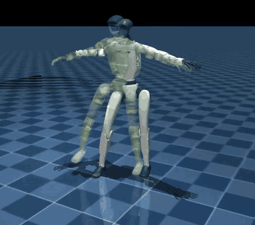
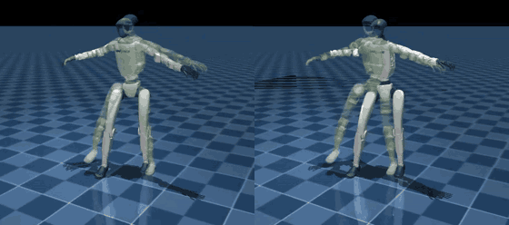
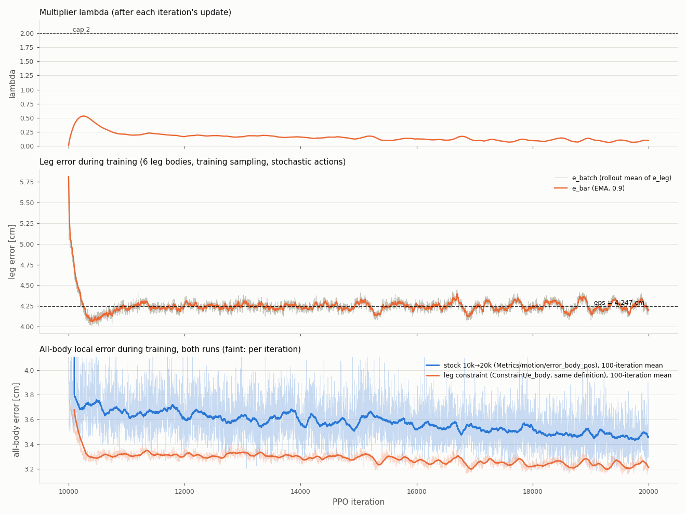
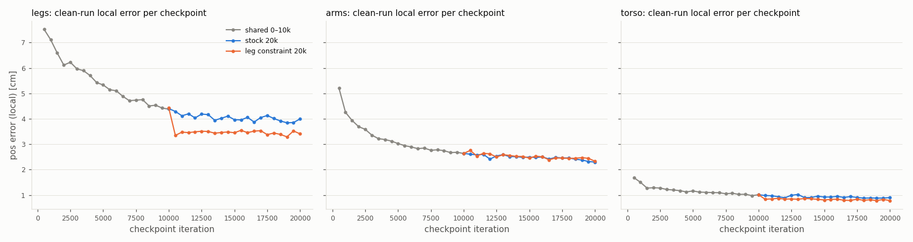

# EDGE → Unitree G1: music-driven humanoid dance

<p align="center">
  
</p>

A simulated Unitree G1 dancing 30 s of motion that [EDGE](https://github.com/Stanford-TML/EDGE) generated from
a song it had never heard. The motion is retargeted with [GMR](https://github.com/YanjieZe/GMR) and tracked by a
physics-based policy trained with [mjlab](https://github.com/mujocolab/mjlab) (BeyondMimic recipe). Above: the
final leg-constraint policy on the clean run; the green ghost is the reference.
[Full 30 s clip with audio](results/funkorama/leg_constraint_clean_run.mp4).

<p align="center">
  
  <br><em>Left: stock reward, 20k iterations. Right: leg constraint, 20k iterations. Same reference and start.
  The 0.5 cm leg difference is too small to see; the table below has it.
  <a href="results/funkorama/stock_vs_leg_constraint.mp4">Full clip with audio</a>.</em>
</p>

```
song.wav ──EDGE──▶ SMPL dance ──GMR──▶ G1 joint motion ──foot fix──▶ clean G1 motion ──mjlab PPO──▶ G1 policy
```

This is a fork of the official EDGE implementation, adapted to run on a single 8 GB laptop GPU (RTX 5060,
WSL2) and extended with G1 retargeting, RL tracking, an evaluation suite and a constrained-RL reward variant.

## Summary

- **It dances the whole clip.** The tracking policy completes the 30 s clip in 50 of 50 randomized episodes.
  Playing the same reference open loop, without a policy, falls after 0.56 s.
- **It tracks to about 3 cm** relative to the torso, but the legs, especially the ankles, carry most of the error.
  Fast motion, foot contact and the episode reset explain only a small part of it.
- **A leg constraint cuts leg error by 13 %.** A leg tracking term weighted by a Lagrange multiplier, which rises
  whenever leg error is above a target, took leg error from 4.33 to 3.77 cm against a control trained for the same
  10,000 extra iterations. Arm error is unchanged, and action rate rises 4 %.
- Two findings that matter beyond this clip:
  - **The stock position reward is almost flat at these errors.** With σ = 0.3 m it scores 4 cm and 5 cm nearly
    the same (0.982 vs 0.973), so it gives little signal for fine leg tracking.
  - **The retargeter can create motion faster than the human ever moved.** GMR held a shoulder at its joint limit
    and then released it: a 100° swing in 0.13 s, about three times the speed of the original arm.

## Results

All numbers are for the song *funkorama*, one EDGE sample (seed 0), one training seed (42). Full reports, with
every definition, threshold and provenance, are in [`results/funkorama/reports/`](results/funkorama/reports/).

| Policy | Training | Report |
|---|---|---|
| `stock_10k` | stock task, iterations 0 → 10,000 | [stock_10k.md](results/funkorama/reports/stock_10k.md) |
| `stock_20k` | stock task, resumed 10,000 → 20,000 (the control) | [stock_20k.md](results/funkorama/reports/stock_20k.md) |
| `leg_constraint_20k` | leg-constraint task, resumed from the same 10k checkpoint → 20,000 | [leg_constraint_20k.md](results/funkorama/reports/leg_constraint_20k.md) |
| comparison | `stock_20k` vs `leg_constraint_20k`, paired tests | [comparison.md](results/funkorama/reports/comparison.md) |

### Evaluation protocol

Every evaluation runs the deterministic policy over the full clip from frame 0. Training only ever saw 10 s
windows, so a full run also tests whether errors build up over 30 s.

| Run | Episodes | Conditions |
|---|---|---|
| Clean | 1 (repeated 5 times) | no randomization, noise or pushes |
| Randomized | 50 (seeds 1000–1049) | training's reset perturbations, friction and mass randomization, observation noise |
| Randomized with pushes | 50 (seeds 11000–11049) | as above, plus training's random pushes every 1 to 3 s |
| Friction sweep | 1 each | foot friction 0.3, 0.6 and 1.2 |
| Open loop | 1 | reference joint angles sent straight to the motors, no policy |

An episode succeeds if it reaches the end of the clip without triggering any of training's terminations (torso
height error > 0.25 m, torso tilt past the training threshold, ankle or wrist height error > 0.25 m).
**Local** error is measured after aligning the reference to the robot's torso position and heading, as the
reward does. **Global** error is in the world frame, so it includes drift. The GPU simulator isn't bit-for-bit
reproducible; five clean repeats varied by less than 0.02 cm.

### Baseline at 10,000 iterations

- **Completion:** 50/50 randomized, 49/50 with pushes (the failure ended at 0.38 s, before any push, from its
  reset perturbation), all three friction settings. Open loop falls after 0.56 s.
- **Accuracy (randomized set):** local error 3.4 cm, global error 7.5 cm, joint angles 4.6°. Global error is about
  6.5 to 9.5 cm for every body, so it is mostly a shared drift that the reward doesn't penalize. For context,
  the GMR authors' study (*Retargeting Matters*) reports 2.8 cm local and 10.4 cm global error for the same
  tracker over 21 mocap clips, measured differently, so this is only a rough check.

| Body group | Local error, mean (cm) | Local error, 95th pct (cm) |
|---|---|---|
| Torso and pelvis | 1.0–1.1 | 2.8–3.0 |
| Hips | 2.0–2.2 | 4.5–5.6 |
| Shoulders and elbows | 1.7–2.9 | 3.6–5.9 |
| Wrists | 4.0–4.1 | 8.5–9.0 |
| Knees | 4.5–4.9 | 10.1–12.5 |
| Ankles | 7.1–7.8 | 15.0–18.4 |

What the tracker changed about the motion (clean run): it is about twice as smooth and almost never near a joint
limit, with zero lag. Torque saturated in 0.12 % of physics steps, all at the waist roll.

| Metric | Reference | Executed |
|---|---|---|
| Joint jerk, mean (rad/s³) | 920 | 473 |
| Peak joint speed (rad/s) | 25.3 | 16.4 |
| Frames with a joint within 3° of its limit | 35.2 % | 1.2 % |
| Lag behind the reference (ms) | | 0 |

Training took 4.8 h for 10,000 iterations (about 58,000 simulation steps/s); the first checkpoint able to
complete the clip was at iteration 500.

### Where the leg error comes from

| Candidate | Test | Result |
|---|---|---|
| Fast motion | each body's error vs its limb's reference joint speed | real but weak for the legs (r ≈ 0.3; fastest 10 % of frames have 1.5× the error); none for the arms |
| Reset transient | start episodes at 2, 5 and 10 s | ruled out: error at each moment is the same whatever the start, within 0.1 cm |
| Foot contact | ankle error where the reference foot slides while planted | small: 7.3 vs 5.0 cm, but fewer than 100 frames per foot |
| Clamped frames | do speed spikes fall on the 76 frames clamped to joint limits? | ruled out for the largest arm spike |

Leg error peaks 60 to 100 ms *before* reference speed peaks, consistent with a policy that starts fast moves
early to spread the acceleration (untested). The 23.3 s arm spike is a retargeting artifact: GMR solves each
frame independently, held the left shoulder at its limit while the human arm moved past it, then caught up all at
once (22 rad/s, while the human arm moved at most 6.3 rad/s).

Plots: [error over time](results/funkorama/plots/stock_10k/error_over_time.png),
[per body](results/funkorama/plots/stock_10k/per_body_error.png),
[per body vs iteration](results/funkorama/plots/stock_10k/per_body_error_vs_iteration.png),
[error vs joint speed](results/funkorama/plots/stock_10k/error_vs_joint_speed_scatter.png),
[start-time test](results/funkorama/plots/stock_10k/diagnostics_start.png),
[contact](results/funkorama/plots/stock_10k/diagnostics_contact.png),
[clipping](results/funkorama/plots/stock_10k/diagnostics_clipping.png).

### Improving leg tracking: a Lagrangian leg constraint

Since none of those causes explained most of the leg error, and leg error was still falling at 10k while the arms
had levelled off, the legs looked under-trained.

**Control.** The stock run resumed from 10k to 20k: body-mean local error 3.41 → 3.07 cm, legs 4.75 → 4.33 cm.
The constrained run starts from the same 10k checkpoint and trains the same 10,000 iterations with the same seed
and settings; the reward is the only difference.

**Method** ([`g1/leg_constraint.py`](g1/leg_constraint.py)). A leg term is added to the unchanged stock reward:

```
r_leg = λ · exp(−e_leg² / σ_leg²)               e_leg: mean local position error of the 6 leg bodies
ē ← β·ē + (1−β)·e_batch                          once per PPO iteration, before the policy update
λ ← clip(λ + α·(ē − ε)/ε, 0, λ_max)
```

β = 0.9, α = 0.02, λ_max = 2, λ starts at 0, σ_leg = 0.06 m, and ε = 4.247 cm = 0.9 × the stock run's leg error
at 20k (measured from its checkpoint under the training sampling, since the training logs have no leg-group
error). At λ = 0 the total reward equals the stock reward bit for bit on the same batch
([`g1/leg_constraint_check.py`](g1/leg_constraint_check.py) `equal`). λ and ē are saved in every checkpoint.

**A failed first attempt.** With the stock σ = 0.3 m the term is 0.97–0.98 at 4–5 cm, i.e. a λ-scaled alive bonus
with no gradient on leg error; λ ran to the cap and the run was stopped. σ_leg = 0.06 m puts the steep part of the
curve at the current error (0.61 at the target, 0.50 at 5 cm).

**Results** (iteration 20,000, same 50 randomized seeds, paired Wilcoxon):

| Metric | Stock 20k | Leg constraint 20k | Change |
|---|---|---|---|
| Legs, local error (cm) | 4.33 | 3.77 | −13 % (lower on 50/50 seeds, p = 2e-15) |
| Arms, local error (cm) | 2.52 | 2.54 | +0.02 cm |
| Torso, local error (cm) | 0.95 | 0.84 | −12 % |
| All bodies, local error (cm) | 3.07 | 2.82 | −8 % |
| All bodies, global error (cm) | 6.77 | 6.55 | −3 % (p = 0.011) |
| Completion | 50/50 | 50/50 | none |
| Action rate | 0.787 | 0.816 | +4 % |
| Joint jerk (rad/s³) | 655 | 663 | +1 % |
| Torque saturation (frames) | 0.20 % | 0.16 % | −0.04 pt |

With pushes the pattern is the same (legs 4.73 → 4.20 cm). λ rose to 0.53 in the first 250 iterations, fell as ē
reached the target, and ended at 0.10, never at the cap; ē held at ε and finished at 4.21 cm.

<p align="center">
  
  <br>
</p>

### Limitations

- **One training seed.** The paired test shows this constrained policy beats this stock policy, not how much the
  gap varies across training runs.
- **Which part helped.** λ spent most of the run between 0.1 and 0.5, so the tight σ_leg may matter more than the
  adaptive weight. A fixed leg term (σ = 0.06 m, weight ≈ 0.3) would separate the two.
- **One clip, generated motion only.** No mocap clip went through the same pipeline.
- **Music timing isn't evaluated.** Real AIST++ dancers also score near chance on the standard beat alignment score
  over 25 s clips, so it was dropped. The tracker keeps the reference's timing exactly (zero lag).
- **Simulation only.** The policy observes quantities that need state estimation on a real G1.

Next steps: tighten ε in steps to see how far the legs go before arms, smoothness or completion suffer, and add a
velocity limit inside the retargeting IK to remove the joint-limit catch-up artifact.

## Setup

Tested on Windows 11 + WSL2 (Ubuntu), RTX 5060 Laptop (8 GB VRAM, sm_120), NVIDIA driver 592.15, 7 GB RAM
given to WSL, [uv](https://docs.astral.sh/uv/) 0.13.7. Three separate environments are used:

| Environment | Where | Python | Key versions |
|---|---|---|---|
| EDGE | `.venv/` in this repo | 3.14.4 | torch 2.15.0+cu132, numpy 2.5.4, librosa 1.0.0, accelerate 1.15.0, jukebox @ `08efbbc`, jukemirlib @ `a91d87f`; full list in [`requirements-edge.txt`](requirements-edge.txt) |
| GMR | `$GMR_DIR` (default `/home/bwork/GMR`) | 3.10.22 | GMR @ `25f56db`, mujoco 3.13.0, mink 1.3.0, numpy 2.2.6 |
| mjlab | `$MJLAB_DIR` (default `/home/bwork/mjlab`) | 3.13.18 | mjlab 1.6.0 @ `d0ad1fe`, mujoco 3.16.0, mujoco-warp 3.16.0, warp-lang 1.18.0, torch 2.14.0 (CUDA 13), rsl-rl-lib 5.5.2 |

```bash
# 1. EDGE environment (this repo)
uv venv --python 3.14 .venv
VIRTUAL_ENV=.venv uv pip install torch==2.15.0 --index-url https://download.pytorch.org/whl/cu132
VIRTUAL_ENV=.venv uv pip install --no-deps -r requirements-edge.txt   # jukebox/jukemirlib must stay --no-deps
cp -r third_party/pytorch3d_stub/pytorch3d .venv/lib/python3.14/site-packages/   # pure-Python pytorch3d subset
ln -s "$(.venv/bin/python -c 'import imageio_ffmpeg; print(imageio_ffmpeg.get_ffmpeg_exe())')" .venv/bin/ffmpeg

# 2. weights
bash download_model.sh                                  # EDGE checkpoint.pt (1.2 GB)
mkdir -p ~/.cache/jukemirlib
wget -O ~/.cache/jukemirlib/vqvae.pth.tar        https://openaipublic.azureedge.net/jukebox/models/5b/vqvae.pth.tar
wget -O ~/.cache/jukemirlib/prior_level_2.pth.tar https://openaipublic.azureedge.net/jukebox/models/5b/prior_level_2.pth.tar  # 10.3 GB
# the per-layer prior shards (9.6 GB) are built automatically on the first generate_dance.sh run

# 3. GMR (retargeting)
git clone https://github.com/YanjieZe/GMR.git ~/GMR && cd ~/GMR && git checkout 25f56db && uv sync --python 3.10

# 4. mjlab (RL)
git clone https://github.com/mujocolab/mjlab.git ~/mjlab && cd ~/mjlab && git checkout d0ad1fe && uv sync --extra cu130
```

Point the scripts at your clones with `export GMR_DIR=~/GMR MJLAB_DIR=~/mjlab`. The scripts in `g1/` and
`policy_eval/` re-launch themselves in the right venv, so any `python3` works.

**WSL2 notes**
- The GPU comes from the Windows NVIDIA driver; don't install a Linux driver inside WSL. Check with `nvidia-smi`.
- RTX 50xx (sm_120) needs CUDA 13 torch: hence `cu132` for EDGE and `--extra cu130` for mjlab.
- Training peaks at about 5–6 GB of system RAM. If WSL has less, raise `memory=` in `%UserProfile%\.wslconfig`.
- Keep the repo and data on the Linux filesystem; `/mnt/c` is much slower.
- There's no system ffmpeg; `.venv/bin/ffmpeg` (imageio-ffmpeg's binary) is used for all video and audio.
- To watch a policy, the browser viewer is the most reliable under WSL: add `-- --viewer viser` to `--play` and
  open http://localhost:8080.

Not needed: the SMPL-X body model (GMR is fed joint positions and rotations directly), and stock jukemirlib's 13 GB
of VRAM (features stream one Jukebox layer at a time). [`CLAUDE.md`](CLAUDE.md) lists the pitfalls already solved.

## Reproducing the results

The commands in order, with the settings used. `R` is the run folder that step 1 creates. The song
`custom_music/funkorama.wav` is not included; any `.wav` without `_` in its name works the same way.

```bash
# 1. generate: 30 s EDGE dance, seed 0 (random window = slice 3, so motion frame 0 = 7.5 s into the song),
#    guidance 2, then GMR retarget (height 1.66 m) and foot cleanup                          ~2.5 min
./generate_dance.sh custom_music/funkorama.wav --seed 0 --g1
R=outputs/funkorama_<timestamp>

# 2.-3. retarget and foot cleanup are part of --g1; standalone, on an existing run:
python3 g1/edge_to_g1.py $R/ --video          # -> funkorama_g1.pkl
python3 g1/fix_g1_feet.py $R/ --video         # -> funkorama_g1_fixed.pkl (use this one)
python3 g1/eval_g1_motion.py $R/ --g1 g1_fixed   # retarget quality report

# 4.-5. convert (12 Hz low-pass, 30 -> 50 fps, clamp to joint limits) and train the stock policy:
#    4096 envs, 10,000 iterations, seed 42, checkpoint every 500                              ~4.8 h
./train_g1_tracking.sh $R/
S10=2026-11-12_20-43-24_funkorama              # the folder this created in $R/rl/g1_tracking/

# control: resume the stock run from 10k for another 10,000 iterations
./train_g1_tracking.sh $R/ --iters 10000 --resume -- --agent.load-run $S10 --agent.load-checkpoint model_9999.pt

# leg constraint: same, with the variant task (λ starts at 0 because the stock checkpoint has no multiplier)
python3 g1/leg_constraint_check.py equal --train_dir $R/rl/g1_tracking/$S10 --checkpoint model_9999.pt   # λ=0 == stock
./train_g1_tracking.sh $R/ --iters 10000 --resume --leg-constraint -- --agent.load-run $S10 --agent.load-checkpoint model_9999.pt

# 6. evaluate each final checkpoint (~1 h each), then compare
T=$R/rl/g1_tracking
python3 policy_eval/evaluate.py $R/ --train_dir $T/$S10                 --out $R/eval/stock_10k
python3 policy_eval/evaluate.py $R/ --train_dir $T/<stock 10k->20k dir> --out $R/eval/stock_20k
python3 policy_eval/evaluate.py $R/ --train_dir $T/<leg constraint dir> --out $R/eval/leg_constraint_20k
python3 policy_eval/compare_runs.py --a $R/eval/stock_20k --b $R/eval/leg_constraint_20k --base $R/eval/stock_10k \
    --la "stock 20k" --lb "leg constraint 20k" --out $R/eval/compare_stock20k_vs_legc20k

# optional: error-source diagnostics on the 10k policy (needs the start-frame runs, see the script's docstring)
python3 policy_eval/plot_error_vs_speed.py $R/eval/stock_10k
python3 policy_eval/error_diagnostics.py  $R/eval/stock_10k

# watch a policy in the browser (http://localhost:8080)
./train_g1_tracking.sh $R/ --play --checkpoint $T/<dir>/model_19998.pt -- --viewer viser
```

The ε of the leg constraint (4.247 cm) is already set in `g1/leg_constraint.py`. To re-measure it on your own
stock 20k checkpoint: `python3 g1/leg_constraint_check.py eps --train_dir $T/<stock 20k dir> --checkpoint model_19998.pt --envs 4096`.
Results will differ slightly from the numbers above: the GPU simulation is not bit-for-bit reproducible across
processes, and EDGE's Jukebox features depend on the exact song file.

### `train_g1_tracking.sh` options

| Option | Default | Meaning |
|---|---|---|
| `--envs N` | 4096 | parallel simulations (1.9 GB VRAM, about 1.45 s per iteration on an RTX 5060 Laptop) |
| `--iters N` | 10000 | PPO iterations, checkpoint every 500 |
| `--smooth-hz F` | 12 | low-pass cutoff for the reference, 0 = off |
| `--leg-constraint` | off | train the leg-constraint variant instead of the stock task |
| `--resume` | off | continue from a checkpoint (newest, or `-- --agent.load-run D --agent.load-checkpoint F`) |
| `--play [--checkpoint F] [--video]` | off | viewer instead of training |
| `--no-state-est` | off | policy without base position / linear velocity inputs (for real hardware) |
| `--wandb` | off | log to Weights & Biases instead of TensorBoard |
| `-- ARGS` | | passed to mjlab, e.g. `-- --env.rewards.motion-body-pos.weight 2.0` |

## Repository layout

```
generate_dance.sh          song.wav → EDGE dance → SMPL-X (+ G1 retarget and foot fix with --g1)
train_g1_tracking.sh       dance → mjlab reference → PPO training (stock or --leg-constraint) / --play
g1/
  edge_to_g1.py            EDGE → G1 with GMR, straight from EDGE's joints (no SMPL-X body model)
  fix_g1_feet.py           removes floor penetration, locks planted feet (leg IK in MuJoCo)
  eval_g1_motion.py        retarget quality: fidelity, floor, skating, limits, velocities
  edge_to_mjlab.py         G1 motion → mjlab tracking reference (low-pass, 50 Hz, body states)
  edge_to_smplx.py         EDGE → AMASS-style SMPL-X .npz (for other retargeters)
  leg_constraint.py        the leg-constraint reward variant: task registration, reward term, λ update, logging
  train_leg_constraint.py  mjlab's train CLI with the variant registered
  leg_constraint_check.py  λ = 0 equals stock (equal), ε measurement (eps), stock reward composition (shares)
policy_eval/               evaluation of a trained policy (see policy_eval/README.md)
  evaluate.py              full protocol: clean, randomized, pushes, friction, open loop → report.md, metrics.json, plots
  rollout.py / metrics.py  rollouts in mjlab, and the pure-numpy metrics shared by reference and executed motion
  compare_runs.py          two evaluations side by side with paired tests, error per checkpoint, λ / ē plot
  plot_error_vs_speed.py, error_diagnostics.py   where the tracking error comes from
  edge_bas.py              beat alignment score of EDGE motions and real AIST++ dances
results/funkorama/         demo GIFs and videos, reports and plots of the three policies (tracked in git)
third_party/pytorch3d_stub pure-Python subset of pytorch3d.transforms (BSD, Meta) that EDGE needs
requirements-edge.txt      pinned packages of the EDGE environment
EDGE.py, test.py, vis.py, args.py, model/, dataset/   EDGE diffusion model and inference (upstream)
data/audio_extraction/     Jukebox features: jukebox_lowmem.py (fits 8 GB), shard_jukebox_prior.py
```

Each run writes to `outputs/<song>_<timestamp>/` (not tracked in git):

| Path | Content |
|---|---|
| `<song>.pkl` | EDGE motion: SMPL poses, root translation, joint positions, foot contacts (30 fps) |
| `<song>_g1.pkl`, `<song>_g1_fixed.pkl` | G1 motion in GMR's format (root pose + 29 joints); use `_fixed` |
| `<song>_mjlab_motion.npz` | mjlab tracking reference (50 Hz) |
| `rl/g1_tracking/<timestamp>_<song>/` | checkpoints (`model_*.pt`), `policy.onnx`, TensorBoard logs, `leg_constraint.csv` for the variant |
| `eval/<name>/` | `report.md`, `metrics.json`, `episodes.csv`, `plots/`, `clean_run.mp4`, `raw/` rollouts |

For funkorama the eval folders are `stock_10k/`, `stock_20k/`, `leg_constraint_20k/` and
`compare_stock20k_vs_legc20k/`; `results/funkorama/` holds copies of their reports and main plots.

## Credits

Built on **EDGE: Editable Dance Generation From Music** (CVPR 2023), Jonathan Tseng, Rodrigo Castellon,
C. Karen Liu ([paper](https://arxiv.org/abs/2211.10658), [code](https://github.com/Stanford-TML/EDGE)),
which uses [Jukebox](https://github.com/openai/jukebox) features and lucidrains'
[Adan](https://github.com/lucidrains/Adan-pytorch) and
[diffusion](https://github.com/lucidrains/denoising-diffusion-pytorch) code.
Retargeting by [GMR](https://github.com/YanjieZe/GMR); RL by [mjlab](https://github.com/mujocolab/mjlab),
a re-implementation of [BeyondMimic](https://beyondmimic.github.io/).

```bibtex
@article{tseng2022edge,
  title={EDGE: Editable Dance Generation From Music},
  author={Tseng, Jonathan and Castellon, Rodrigo and Liu, C Karen},
  journal={arXiv preprint arXiv:2211.10658},
  year={2022}
}
```

MIT License (see `LICENSE`, original copyright Jonathan Tseng). `third_party/pytorch3d_stub` contains code from
pytorch3d (BSD license, Meta Platforms).
